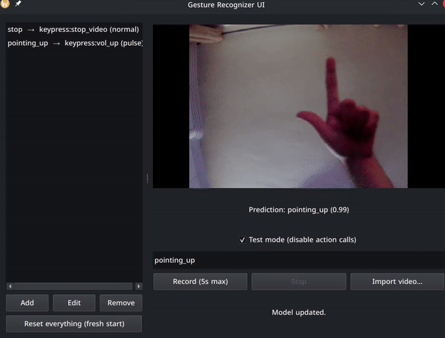
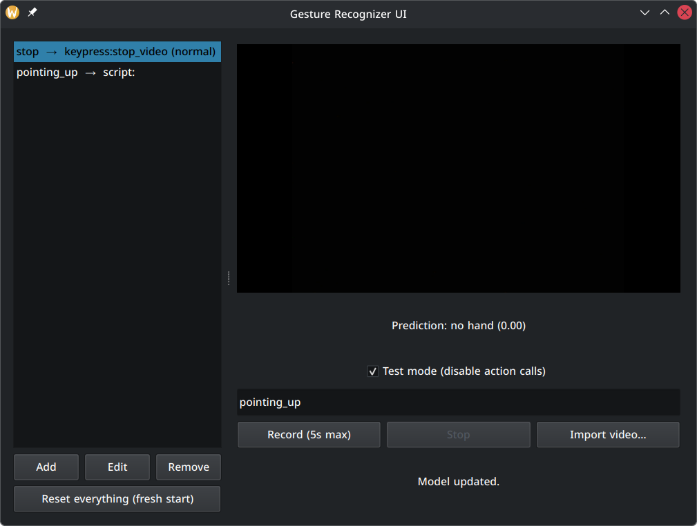
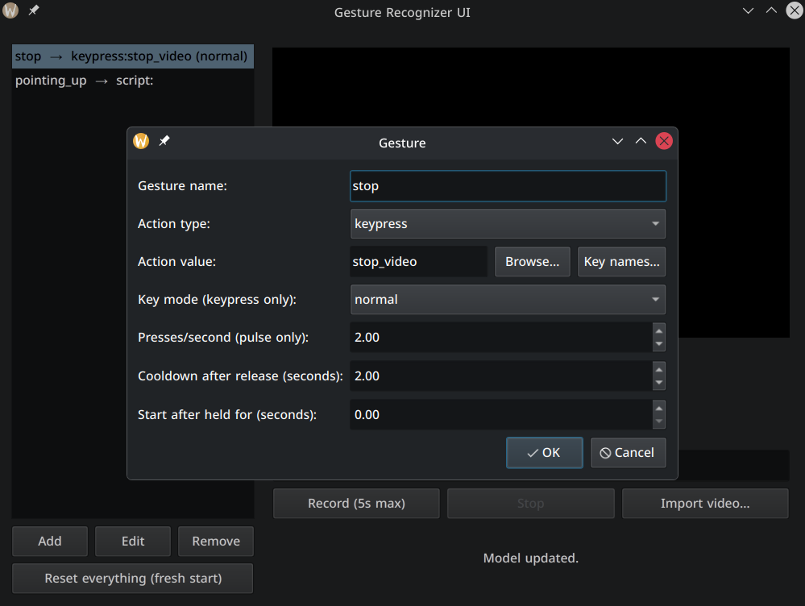

# Hand Gestures AI

A PyQt6 desktop app that recognizes custom hand gestures from your webcam and binds them to keypresses or scripts. Gestures are **static hand poses** — think a stop sign, a peace sign, a thumbs up — not movements. Record a pose, train a classifier on it, assign an action, and the app fires that action live whenever it detects the pose.

## How it works

1. **Record** — capture a short clip (5 s max, webcam or imported file) of yourself holding the pose. Moving your hand slightly while recording gives the model varied samples.
2. **Train** — hand landmarks are extracted with a pretrained [MediaPipe hand-landmark model](https://ai.google.dev/edge/mediapipe/solutions/vision/hand_landmarker) and a small MLP classifier is trained/updated on them.
3. **Bind** — assign each gesture an action in the gestures panel (see below).
4. **Run** — with Test mode off, the inference loop dispatches the bound action live as gestures are recognized.

## UI overview

- **Gestures panel**: list of gesture → action bindings (Add / Edit / Remove / Reset everything).
- **Camera preview**: live feed with the current prediction and confidence shown below it.
- **Test mode**: when checked, predictions are shown but no actions are triggered — safe for trying out new gestures.
- **Record / Import video**: record live (5s max) or import an existing video file as training data.

### Actions

Each gesture binds to either a **keypress** or a **custom script**, with per-gesture tuning:

- **Key mode** — `normal` (fire once per detection) or `pulse` (repeated presses while the pose is held, at a configurable presses/second rate — useful for things like volume or scrolling).
- **Cooldown after release** — minimum seconds before the action can fire again.
- **Start after held for** — the pose must be held this long before the action triggers, which filters out accidental detections.

## Demo

Pointing up pulses the volume up (OSD shows it climbing), an open palm is detected as `stop`, with confidence scores live below the feed:



## Screenshots

| Main window — gesture bindings and live preview | Gesture dialog — action configuration |
|---|---|
|  |  |

## Project structure

```
Hand-Gestures-To-Action/
├── main.py                    # app entry point, system tray + QApplication setup
├── config.py                  # settings, GestureMLP model definition, device setup
├── settings.yaml              # user/app settings
├── gesture_model.pth          # trained model weights
├── hand_landmarker.task       # pretrained hand-landmark model (Google MediaPipe)
├── cache/                     # cached landmark samples per gesture
├── config/                    # config module
├── models/                    # saved models
└── src/
    ├── actions.py              # action_manager: dispatches keypress/script actions
    ├── dataset_loader.py       # landmark extraction, normalization, dataset loading
    ├── gesture_store.py        # load/save/ensure gesture bindings
    ├── inference.py             # InferenceWorker: real-time landmark -> prediction -> action
    ├── keys.py                  # keypress definitions (pynput)
    ├── recorder.py               # webcam recording + video import, sample saving
    ├── trainer.py                 # MLP training loop
    └── ui/
        ├── main_window.py         # MainWidget: top-level layout
        ├── gestures_panel.py      # gesture bindings list panel
        └── gesture_dialog.py      # add/edit gesture dialog
```

## Requirements

- Python 3.14
- PyQt6
- torch
- mediapipe
- opencv-python (`cv2`)
- pynput
- PyYAML
- numpy

```bash
pip install -r requirements.txt
```

## Usage

```bash
python main.py
```

1. In the gestures panel, click **Add** and give your gesture a name.
2. Click **Record (5s max)** and perform the gesture in front of the camera (or **Import video...** to use existing footage).
3. Train the model on the recorded samples.
4. Assign a keypress or script action to the gesture.
5. Uncheck **Test mode** to enable live actions from the system tray app.

## Safety note

Gestures can be bound to arbitrary keypresses and scripts that run on your machine. Keep **Test mode** on while adding or tuning gestures, and review any script you bind before enabling live actions.

## AI usage

This project was built with substantial assistance from **Claude** (Anthropic) as an AI pair-programmer for design, implementation, and debugging.

## License

MIT .
